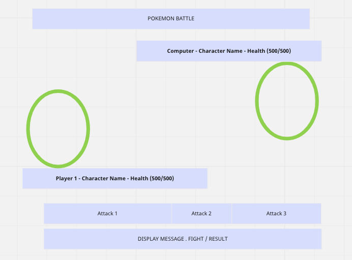

# Pokemon Battle: Charizard vs. Snorlax

A one-page, turn-based battle in the browser. You play Charizard. A CPU plays Snorlax. Built by Prija Cash in 2022 for the General Assembly Software Engineering Immersive.

**Live site:** [prijacash.github.io/pokemon-battle](https://prijacash.github.io/pokemon-battle/)

## What it does

The whole app is one fight. Charizard stands on the left and Snorlax on the right, over a pixel-art forest. Both start at 500 HP, and the page prints those totals as text.

On your turn you choose Ember Fire, Fire Spin, or Blast Burn. Snorlax loses that move's damage, the move's sound plays, and a line under the battlefield names the attack. After 2.5 seconds, Snorlax uses Earthquake, Heavy Slam, or Skull Bash, picked at random, and Charizard loses that much HP. Whoever took the hit has their health line rewritten.

The opening message sets the scene: Jimmy has to beat Snorlax and Brian the Bully. When Snorlax's HP is at or below 0 on his turn, the message says Jimmy won and can go find Julie Ann in the Arctic Mountains, and a victory track plays. When Charizard's HP is already at or below 0 and you press an attack, the message says Brian the Bully won and you cannot pass.

Play Music and Pause Music start and stop a battle track. Reset puts both fighters back to 500 HP, clears the last-move line, restores the opening message, sets the turn count back to the start, and pauses the victory track.

This is a fan project made for class. It is not affiliated with Nintendo or The Pokémon Company.

## Features

- Charizard (you) versus Snorlax (CPU), 500 HP each, shown as text such as `Player 1 Charizard Health (500 / 500)`
- Three player moves with fixed damage, each with its own sound effect
- A CPU move chosen at random from three, played 2.5 seconds after yours. All three CPU moves share one sound effect
- On-screen text for whose turn it is, the move that just landed, and the win or loss
- Battle music with separate play and pause buttons, plus a victory track when you win
- Reset for HP, the messages, and the turn count
- Animated Black/White sprites: Charizard seen from behind, and a shiny Snorlax
- A CSS Grid layout set in the Silkscreen font, following the wireframe in `media/`

### Moves

| Who | Move | Damage | Sound |
| --- | --- | --- | --- |
| Charizard | Ember Fire | 60 | Ember |
| Charizard | Fire Spin | 45 | Fire Spin |
| Charizard | Blast Burn | 30 | Blast Burn |
| Snorlax | Earthquake | 60 | Skull Bash |
| Snorlax | Heavy Slam | 35 | Skull Bash |
| Snorlax | Skull Bash | 13 | Skull Bash |

## Tech stack

- HTML (`index.html`)
- CSS (`css/styles.css`), including CSS Grid and [Silkscreen](https://fonts.google.com/specimen/Silkscreen) from Google Fonts
- Vanilla JavaScript (`scripts/script.js`): DOM updates, one click handler for all three attack buttons, `setTimeout` for the CPU delay, `Math.random` for Snorlax's move, and `Audio` for music and sound effects

The project is those three files, opened in a browser. Sprites and audio are requested from other sites when the page loads. The forest background, `media/battle_background.jpeg`, is stored in the repo.

## Run it locally

```bash
git clone https://github.com/prijacash/pokemon-battle.git
cd pokemon-battle
```

Open `index.html` in a browser. Stay online so the font, sprites, and audio can load. Click an attack, or Play Music, to start the sound.

To serve the folder:

```bash
python3 -m http.server
```

Then open [http://localhost:8000](http://localhost:8000).

## Screenshots



The image above is the layout sketch at `media/pokemon_wireframe.png`. The shipped page follows it, and adds play, pause, and reset under the message.

A screenshot of the running game still needs a home in the repo. Save one as `media/gameplay.png`, then uncomment:

<!--

-->

## What I learned

- The fighters belong in data. Each one is an object with a name, current HP, total HP, and a list of moves, and the health lines are drawn from that.
- All three attack buttons share one click handler. It reads the button's class and maps it to Ember Fire, Fire Spin, or Blast Burn. Without that check, every button ran Ember Fire.
- Snorlax's pause is a `setTimeout` of 2.5 seconds. Working out where to put that delay, so his turn ran after mine, took the longest.
- `Math.floor(Math.random() * 3)` picks one of the three moves on the Snorlax object.
- `new Audio()`, `play()`, and `pause()` cover the move sounds, the battle track, and the victory track.
- Reset has to write the new HP into the page. Putting `500` back on the objects left the old numbers on screen until the health lines were set again.

## What I'd improve

- End the fight on the hit that drops either fighter to 0. The win message and victory track wait for Snorlax's delayed turn. The loss message waits until the next attack click. HP can also count down past 0, so I would clamp it and show the result immediately.
- Ignore extra attack clicks while Snorlax's turn is waiting, and after a winner is already set.
- On reset, stop the battle track and any move sound, and rewind the victory track. Today, reset pauses the victory track.
- Add a visual health bar beside the numbers.
- Give Charizard a short shake when a move lands. His sprite wrapper already has the id `shakeChar`, and nothing in the CSS or JavaScript uses it.
- Serve the sprites and audio from this repo. The page currently loads animated GIFs and every sound from third-party URLs. `media/` already has `charizard.png`, `snorlax.png`, and `snorlax2.png`, and each character object has an empty `image` field.
- Add a character select before the fight. That was the stretch goal I still wanted once this matchup worked.

## Credits

- Sprites: [Pokémon Database](https://pokemondb.net/), Black/White animated GIFs (Charizard's back sprite and shiny Snorlax)
- Audio, loaded at runtime from [VGMsite](https://vgmsite.com/): Generation 3 move sounds (Ember, Fire Spin, Blast Burn, and Skull Bash) and two Game Boy tracks (battle vs. a wild Pokémon, and victory vs. a trainer). The original project notes also credit the [Ten Years of Pokémon](https://downloads.khinsider.com/game-soundtracks/album/pokemon-ten-years-of-pokemon) collection on KHInsider.
- Battlefield: `media/battle_background.jpeg`
- Font: Silkscreen, via Google Fonts
- The original project notes cite [this CodePen](https://codepen.io/hollyos/pen/QNRXYK) as the reference for the character data. This fight uses the same kind of object (a name, 500 HP, and a list of moves) with its own fighters, move names, and fixed damage.
